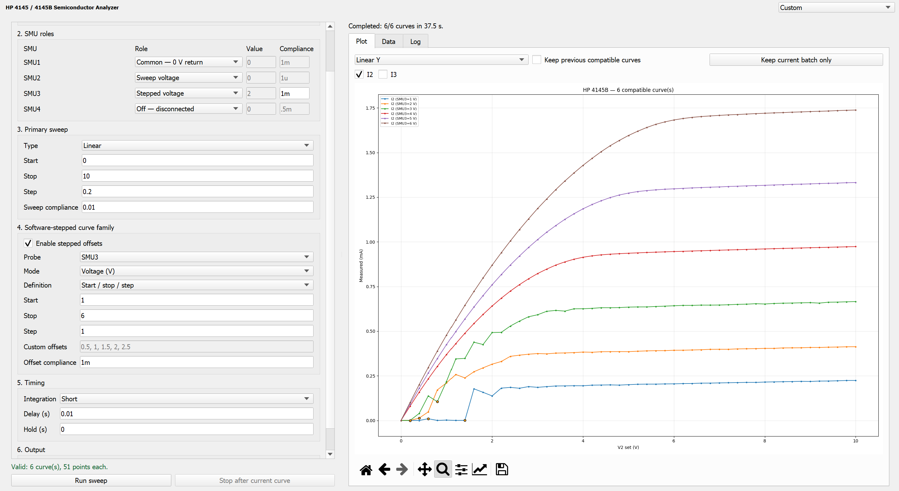

 ### Introduction
A GUI that interfaces with the 4145B Semiconductor Parameter Analyzer made for a microfabrication course in UF

The GUI is able to connect to 4 different probes and customize each of the SMU to the respective VAR1, VAR2, COM, GND, VAR1' in the 4145b machine


In the context for EEE 5354L there is no 4th probe in the probing station so SMU4 should never be used and kept as disconnected. As for the other probes Station 1 is SMU1 for source, SMU2 for drain, SMU3 for gate. This has not been tested for station 2. 

the VAR can only be connected to 1 SMU and multiple SMU can be connected to a constant. the Usage of variables as stated in the manual are not explicitly stated in the GUI but the equivalence is seen below:
- `VAR1  = sweep voltage/current`
- `VAR2  = stepped voltage/current`
- `com   = constant voltage/current`
- `VAR1' = not included`


How this work is VAR1 will sweep from a range with X' from each other. If VAR2 is also utilized then it will stay a constant value until the VAR1 sweep end then VAR2 will increase by the step value and repeat until VAR2 reaches the upper range.

Compliance is used to limit the amount of current allowed in the system for safety reason. 

The hard limit is 100mA and 100 V, but varrying combination of voltage-current would not be allowed too like for example 100mA only allows up to 20V and 40V only allows up to 50mA.

### download

Click the green code button and download as zip file. Remember to also check out the the dependencies

### DEPENDENCIES

- python 3.0
- pivisa
- numpy
- PyQt5
- matplotlib

Libraries instal
```
pip install numpy pyvisa PyQt5 matplotlib
``` 

 - GPIB driver  `NI-488.2`
 - NI visa driver `NI-VISA`
 Note that there might be some BSOD issue if installing the driver from NI on unsupported OS


### Script path process
 > gui -> analyer_sweep -> hp4145 and equipment
 
 output shown on GUI and also exported as CSV file in `/CSV/`

 What happens is when sweep is commences it will call analyzer_sweep with the nescessary parser based on the configurations on the GUI as such the analyzer_sweep can be used by itself and does not rely on the GUI if preferred.

### Files of Interest
parameter_analyzer_gui.py use this file
parameter_analyzer_sweep.py this file is used when a sweep is initiated parsed by the gui
hp4145.py used whenx
equipment.py parent class for hp4145.py


### EXAMPLE
Transistor saturation curve




### References
- equipment.py file came from the dopes library
- hp4145.py is adjusted from the hp4145.py file from the same dopes library

> [Link for dopes](https://pypi.org/project/dopes/)

> [dopes gitlab link aka chopes](https://forge.uclouvain.be/LocLahaye/chopes)

> [4145b manual link by keysight](https://www.keysight.com/dk/en/assets/9018-07935/service-manuals/9018-07935.pdf)


### Bugs

- there is a problem where SMU selection changes by itself
- add a preset feature for certain devices
- implement the ability to analyze data from multiple test runs maybe a different gui for that